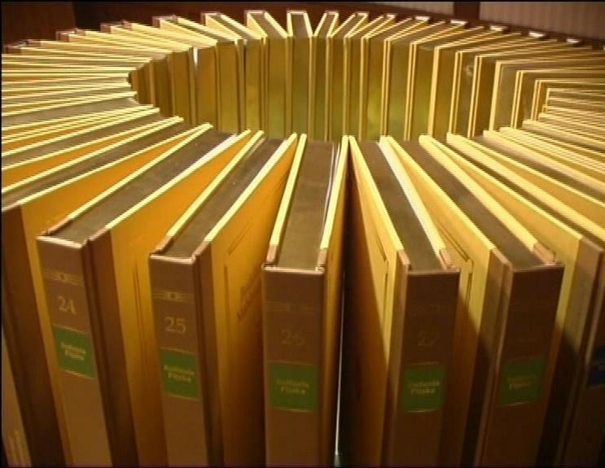

# tipitaka2500.github.io — OpenPāḷi / World Tipiṭaka Edition (2020 Edition)

## The World Tipiṭaka Edition

*“The Buddhist Era 2500 Great International Council Pāḷi Tipiṭaka, Roman Script 2005 / 2020 Edition” (`Mahāsaṅgīti Tipiṭaka Buddhavasse 2500`)*



This repository contains the complete data, conversion pipeline, and [Astro](https://astro.build/) static site for **tipitaka2500.github.io**—a digital reconstruction of the 40-volume Roman-script edition of the 25-century-old teaching of the Buddhist Theravāda tradition in the Pāḷi language from the B.E. 2500 (1957) Great International Buddhist Council, updated to the **2020 Edition**.

Derived from the **Chaṭṭhasaṅgīti (Sixth Buddhist Council) Edition** convened in B.E. 2500 (1956–1957) at Yangon by 2,500 erudite Theravāda Buddhist monks from around the world, the Roman-script edition is the work of **The World Tipiṭaka Project** (1999–2024), initiated by the M.L. Maniratana Bunnag Dhamma Society Fund under the patronage of His Holiness Somdet Phra Ñāṇasaṁvara, the 19th Supreme Patriarch of Thailand.

To eliminate printing anomalies found in earlier manuscripts, canonical Pāḷi experts recited the entire 40-volume text **4 times** between B.E. 2543–2545 (2000–2002) and B.E. 2549–2550 (2006–2007) while collating against 18 international editions across national scripts—verifying all **2,708,706 words** (**9,442,442 syllables** / **20,606,104 Roman letters**) across the **88 books** and **20,189 sections** of the Vinayapiṭaka, Suttantapiṭaka, and Abhidhammapiṭaka.

Created and maintained by **Chris Tham** (`chris@christham.net`).

### CC0 License

This work has been marked as dedicated to the public domain. See the [CC0 1.0 Universal Deed](https://creativecommons.org/publicdomain/zero/1.0/).

---

## Motivation & Purpose

1. **Restoring a Lost Digital Heritage**:
   The original World Tipiṭaka website (which initially published the Roman-script B.E. 2500 Great International Council edition online) ceased operating and no longer exists. This project was originally created to restore a permanent, free, fast, and accessible digital home for the World Tipiṭaka Edition so that this historic 40-volume council text would remain available to scholars, monastic communities, and students worldwide.
2. **Making the 2020 Edition Fully Functional**:
   When the updated 2020 Edition was released through the [Open Pāḷi](https://openpali.sajjhaya.org) database, the official site remained incomplete and not fully functional (its homepage is devoid of content and difficult to navigate). Re-scraping and reconstructing the database under a modern, clean static architecture brings the entire 2020 scholarly apparatus—including all 26,529 critical variant footnotes, 7,938 linked cross-references, and five reference indices—into a reliable, fast, and accessible interface.
3. **An Authoritative Global Reference**:
   Today, `tipitaka2500.github.io` frequently ranks #1 on Google Search as the primary online authority for the Roman-script World Tipiṭaka Edition. It is vital to keep the text deterministically verified, up to date with modern web and accessibility standards, and rigorously maintained.

---

## Architecture & How This Site Was Created

### First Generation (`v1`–`v2.8`)
The initial version of `tipitaka2500.github.io` was based on converting an archival XML scrape of the 2005 website from [yuttadhammo/World-Tipitaka](https://github.com/yuttadhammo/World-Tipitaka) into static HTML files using Python scripts ([tidipa/convert-scripts](https://github.com/tidipa/convert-scripts)), reorganizing the files into a semantic folder hierarchy (`tipitaka/{BookCode}/...`), and embedding a Bootstrap sidebar with the Rosely color scheme.

### Current Generation (`v3.1` — 2020 Edition with Astro 7)
This update brings the website up to date with the **2020 Edition** through a fresh scrape of the [Open Pāḷi](https://openpali.sajjhaya.org) database and a clean separation between canonical HTML content and site presentation:

1. **100% Deterministically Verified Canonical Text**:
   - All **20,189 section HTML files** (`tipitaka/**/*.html`) and **118,280 canonical paragraphs** have been deterministically compared (`compare_tipitaka.py`) against the previous repository to verify that the canonical Pāḷi text is identical (while also restoring 2 missing paragraphs in `7D/2.html` and `9M/1/5/4.html` that had been dropped by an unclosed comment in the legacy XML source).
2. **Clean Vanilla HTML5 Source (`tipitaka/`)**:
   - All 20,189 HTML files in `tipitaka/` are stored as pure, semantic, standards-compliant HTML5 (`<header>`, `<main>`, `<section class="footnotes">`, `<footer>`) with zero Bootstrap classes or navigation chrome embedded in the source files.
3. **Critical Apparatus Footnotes & Live Cross-References**:
   - Includes all **26,529 critical apparatus footnotes** collating Sīhaḷa (`sī`), Syāmaraṭṭha (`syā1–3`), Kambuja (`ka`), Maramma (`ma`), and Pāli Text Society (`pā1–2`) readings.
   - All **7,938 canonical cross-references** in footnotes (`7,134` colon-style refs like `24Mn:1898` and `804` division-style refs like `1V.15/1`) are resolved and hyperlinked directly to `/tipitaka/<path>.html#p_<book>_<pnum>`.
4. **Interactive Reference Indices & Reader Tools (Astro)**:
   - **Quick Jump & Citation Lookup (`⌘K` / `/`)**: Instant lookup for any canonical paragraph citation (e.g. `1V:2`, `18Dh:1`, `24Mn:1898`), book code, or title.
   - **Interactive Reader Popovers**: Click any `[1]` footnote reference for an inline preview with edition tooltips, or click any paragraph number badge to copy its permalink/citation or open it in the reference indices.
   - **Table of Contents (`/toc.html`)**: Browse and search all **20,116** structural sections across the 88 books with paragraph and division ranges.
   - **Index of Verses (`/verses.html`)**: Search and compare all **28,395** canonical verse paragraphs (*Gāthā*) in Roman Pāḷi and Thai Pāḷi script side-by-side.
   - **Critical Apparatus & Notes (`/notes.html`)**: Filter and search all **26,529** textual variant and cross-reference notes by book, note type, or witness edition.
   - **Page Concordances (`/concordances.html`)**: Cross-reference **164,784** paragraph-to-page mappings across 8 printed Tipiṭaka editions (`P1`, `P2`, `Ch1`, `Ch2`, `S`, `B`, `C`, `V`).
   - **Pāḷi Word Index (`/words.html`)**: Search and browse all **146,693** unique Pāḷi headwords across the 41 Pāḷi alphabet letters with Roman Pāḷi, diacritic-insensitive ASCII search, Thai script, IPA phonetic transcription, and book frequency distributions.
   - **Guide & History Pages**:
     - `/guide.html` — Quick Guide to citations, interactive features, collated editions, and Pāḷi pronunciation.
     - `/project.html` — History and innovations of the World Tipiṭaka Project (1893–2024).
     - `/about.html` — About this website and its edition history.

---

## Repository Structure & Scripts

```text
├── tipitaka/                   # 20,189 clean, vanilla HTML5 canonical section files (88 books)
├── pages/                      # Raw scraped Tipiṭaka pages (7,901 pages)
├── toc/                        # Scraped Table of Contents (20,116 entries)
├── verses_index/               # Scraped Index of Verses (28,395 entries)
├── notes/                      # Scraped Critical Apparatus Notes (26,529 entries + editions.json)
├── page_concordances/          # Scraped Page Concordances (164,784 entries + editions.json)
├── word_index/                 # Scraped Pāḷi Word Index (146,693 headwords + alphabets.json)
├── public/
│   ├── data/                   # Sharded JSON indices for fast client-side filtering & search
│   └── images/                 # Site logos, icons, and volume photography
├── src/
│   ├── components/Sidebar.astro
│   ├── layouts/Layout.astro
│   ├── pages/                  # Astro pages (index, guide, about, project, toc, verses, notes, concordances, words, tipitaka/[...slug])
│   └── styles/global.css       # Rosely light/dark theme using CSS color-scheme and light-dark()
├── consolidate_pages.py        # Consolidates raw pages into tipitaka/**/*.html with linked cross-references
├── compare_tipitaka.py         # Deterministic paragraph-by-paragraph verification script
└── build_site_indices.py       # Generates sharded, enriched JSON indices in public/data/
```

### Development & Build Commands

```sh
# Start Astro dev server at http://localhost:4321
npm run dev

# Regenerate consolidated vanilla HTML files in tipitaka/
./consolidate_pages.py

# Rebuild sharded JSON indices in public/data/
./build_site_indices.py

# Build production static site to dist/
npm run build
```

---

## Release History

* **v1**: Initial version based on conversion of XML to HTML then adding Bootstrap
* **v2**: Renamed files by inferring a semantic structure
* **v2.1**: Fixed duplicate links
* **v2.2**: Enabled breadcrumbs
* **v2.3**: Refactored HTML to use Bootstrap for all styling. Turned on paragraph numbering.
* **v2.4**: Enabled deep links for division numbering (`d[0-9]+`) and paragraph numbering, changed colour scheme to Rosely
* **v2.5**: Handled `ENDH3`, `ENDBOOK`, `G`, bold and italic
* **v2.6**: Fixed dark mode not working
* **v2.7**: Handled `SUMMARY`, `firstLetter`, `gathaQuote`, `RLAP`; added titles to files with no titles; removed extraneous text
* **v2.8**: Corrected mistakes in the navigation menu and restored 2 missing paragraphs (`7D:135` and `9M:480`)
* **v3.0**: Complete 2020 Edition update re-scraped from OpenPāḷi and rebuilt with Astro:
  * Clean vanilla HTML5 files in `tipitaka/` (zero Bootstrap classes in source HTML)
  * Deterministically verified 100% canonical text parity across all 20,189 pages and 118,280 paragraphs
  * Added all 26,529 critical apparatus footnotes and 7,938 live cross-reference links
  * Added interactive Table of Contents (`20,116` sections), Index of Verses (`28,395` gāthās in Roman & Thai script), Critical Apparatus (`26,529` notes), Page Concordances (`164,784` entries), and Pāḷi Word Index (`146,693` headwords)
  * Added Global Quick Jump (`⌘K`), interactive footnote/paragraph popovers, Quick Guide (`/guide.html`), World Tipiṭaka Project history (`/project.html`), and About page (`/about.html`)
* **v3.1**: Astro 7 Modernization, Font Standardization & PUA Unicode Normalization:
  * Upgraded to Astro 7 with Rust compiler, Vite 8/Rolldown, and type checking (`@astrojs/check`)
  * Implemented native Astro 7 font handling (`fontProviders.google()` for Noto Sans) with zero CLS Capsize fallbacks and automated self-hosting
  * Normalized 281,540 legacy Thai PUA glyphs (`U+F700` and `U+F70F`) to standard Unicode `ฐ` and `ญ` across all data, canonical HTML files, and indices
  * Added automated XML sitemaps (`@astrojs/sitemap`) and `robots.txt`
  * Updated GitHub Pages deployment workflow (`withastro/action@v6`, `actions/checkout@v7`, `actions/deploy-pages@v5`)
  * Documented project motivations, heritage restoration, and OpenPāḷi database provenance on the About page and README
